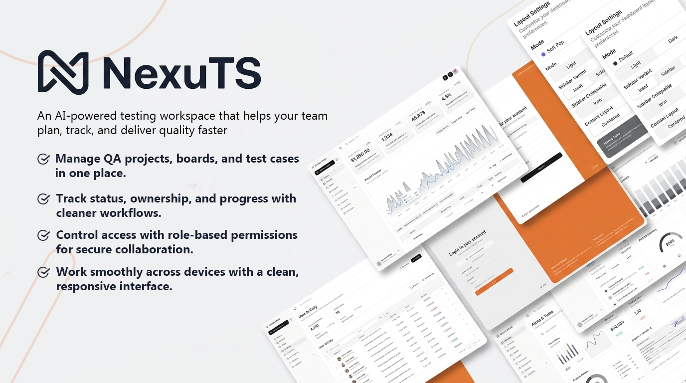

# NexuTS

NexuTS is an AI-powered testing workspace built on Next.js, TypeScript, and Shadcn UI.  
It combines admin dashboards with QA-focused project and test-case management flows.



## Features

- Authentication with NextAuth (credentials flow)
- Role-aware behavior (`ADMIN` and `USER`) for restricted actions
- QA Boards module with project and table management
- Test-case style entry workflows (status, assignment, metadata fields)
- Multiple dashboard sections (`default`, `crm`, `finance`, `execution`, `history`)
- i18n support (English and Arabic)
- Theme presets and layout controls (including sidebar and view-mode preferences)

## Tech Stack

- Next.js 16 (App Router)
- React 19 + TypeScript
- Tailwind CSS v4 + Shadcn UI
- Prisma ORM + SQLite (`prisma/dev.db`)
- NextAuth v5 (beta)
- TanStack Table, React Hook Form, Zod, Zustand
- Biome + Husky + lint-staged

## Project Structure

```text
src/
  app/                  # Routes (auth, dashboard, API)
  actions/              # Server actions (auth/session flows)
  components/           # Shared and feature UI
  config/               # App-level configuration
  lib/                  # Utilities, auth helpers, i18n, Prisma client
  stores/               # Client state stores
prisma/
  schema.prisma         # Data model
  migrations/           # Database migrations
```

## Getting Started

### 1. Install dependencies

```bash
npm install
```

### 2. Configure environment variables

Create or update `.env` in the project root:

```bash
AUTH_SECRET="replace_with_a_long_random_secret"
```

Optional:

```bash
NEXT_PUBLIC_AUTOMATION_ENABLED="true"
```

### 3. Run the app

```bash
npm run dev
```

Open `http://localhost:3000`.

## Scripts

- `npm run dev` - Start development server
- `npm run build` - Create production build
- `npm run start` - Run production server
- `npm run lint` - Run Biome linter
- `npm run format` - Format files with Biome
- `npm run check` - Run Biome checks
- `npm run check:fix` - Run and auto-fix Biome issues
- `npm run validate:clean` - Clean generated files, then format, lint, type-check, and build
- `npm run generate:presets` - Generate theme presets

## Database Notes

- SQLite is used by default (`prisma/dev.db`).
- If you change the Prisma schema, run:

```bash
npx prisma migrate dev
```

## Security Note

User registration in `src/app/api/auth/register/route.ts` currently stores passwords without hashing.  
Before production use, replace this with secure hashing (for example `bcryptjs`).

## Contributing

See [CONTRIBUTING.md](./CONTRIBUTING.md) for contribution workflow and guidelines.

## License

This project is licensed under the [MIT License](./LICENSE).
