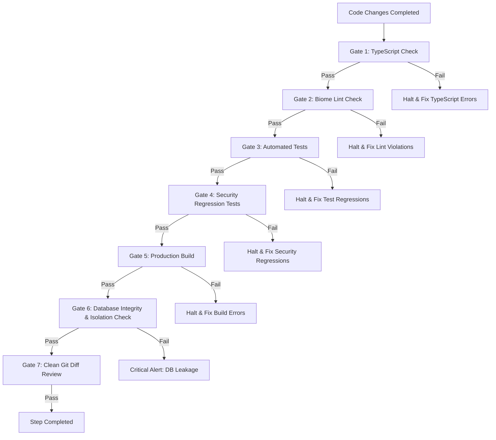

# NexuTS — Development Workflow & Quality Gates

## 1. Branching Strategy
- **`main`:** Production-stable branch. Direct commits, pushes, and feature work on `main` are strictly forbidden.
- **`development`:** Primary integration branch created from `main`. All Phase 1 security tasks and future development must be executed on `development` or isolated topic branches branched from `development`.
- **Topic Branches:** Named using conventions:
  - `feat/<topic>` (Features)
  - `fix/<issue>` (Bug fixes)
  - `sec/<vulnerability>` (Security remediation)
- **Rules:** Never merge, rebase, or commit without passing the quality gates defined below.

---

## 2. Database Isolation & Safety Rules

### 2.1 Dual-Database Policy
- **Tracked Database (`prisma/dev.db`):**
  - Must remain strictly untouched throughout development.
  - Never run migrations, seeds, or resets against `prisma/dev.db`.
  - Checksum must be verified before and after each phase (`sha256sum prisma/dev.db`).
- **Isolated Development Database (`prisma/dev-isolated.db`):**
  - All local development, test runs, and migrations must target `prisma/dev-isolated.db`.
  - Excluded from version control via `.gitignore` and `.git/info/exclude`.
  - Configured locally via untracked `.env.local`:
    ```bash
    DATABASE_URL="file:./dev-isolated.db"
    ```

### 2.2 Startup Guardrails
- `src/lib/prisma.ts` contains an explicit fail-closed guard: if `DATABASE_URL` specifies a database file that does not exist on disk, startup immediately terminates with an error. Never bypass or disable this guard.
- When running Next.js scripts manually, always ensure the environment override is present:
  ```bash
  DATABASE_URL="file:./dev-isolated.db" npm run dev
  DATABASE_URL="file:./dev-isolated.db" npm run build
  ```

---

## 3. Mandatory Quality Gates

Every implementation step must pass the following sequence of quality gates before work is considered complete:



### Gate 1: TypeScript Compilation
Ensures type safety across all components and server actions without emitting build artifacts:
```bash
npx --no-install tsc --noEmit --incremental false
```
*Criterion:* Exit code `0`, 0 errors.

### Gate 2: Biome Linting
Validates syntax rules and detects suspicious practices:
```bash
npx --no-install biome lint .
```
*Criterion:* Exit code `0`, no new warnings or errors introduced.

### Gate 3: Automated Unit & Integration Tests (Introduced in Phase 1)
Validates core logic, permissions, and regressions:
```bash
npm test
```
*Criterion:* All test suites pass.

### Gate 4: Targeted Security Regression Check
Validates that resolved vulnerabilities (e.g., password leakage, unauthenticated mutations) remain patched:
- Check `GET /api/projects` does not return password fields.
- Check unauthenticated mutation attempts return `401 Unauthorized`.
*Criterion:* All security checks pass.

### Gate 5: Production Build
Ensures the Next.js compilation, bundling, and route generation succeed:
```bash
DATABASE_URL="file:./dev-isolated.db" npm run build
```
*Criterion:* Exit code `0`, successful dynamic/static page generation.

### Gate 6: Database Isolation & Integrity Check
Verifies the production/original database remains pristine:
```bash
sha256sum prisma/dev.db
# Must match: bfc6da8e0911483c70cebda47dd1b041e09cb4a68ffe03ba755cd7ebfb5c2615
```
*Criterion:* SHA-256 is 100% identical.

### Gate 7: Git Diff Review
Inspects staged and unstaged changes:
```bash
git diff
```
*Criterion:* No stray files, no leaked credentials, no accidental formatting changes outside task scope.

---

## 4. Policy on Pre-Existing Baseline Debt

### 4.1 Biome Check Formatting Debt
- `npx --no-install biome check .` currently flags 19 errors (17 import-sorting discrepancies, 2 formatting issues).
- **Rule:** Do NOT execute repository-wide formatting (`biome check --write` or `npm run format`) during functional or security implementation steps.
- Repository formatting must be addressed as a dedicated, isolated task to prevent massive git diffs that obscure security and logic changes.
- **Pre-commit Notice:** `.husky/pre-commit` runs `lint-staged` with `biome check --write`. Developers must avoid staging files with formatting drift until this debt is resolved.

### 4.2 Legacy Code Debt
- `deprecated/` contains legacy unused assets moved during prior cleanups (`*.disabled`). These must remain outside active `src/` bundles.
- Legacy SQL workarounds in `src/app/api/projects/route.ts` must be retired cleanly during Phase 1 API refactoring.

