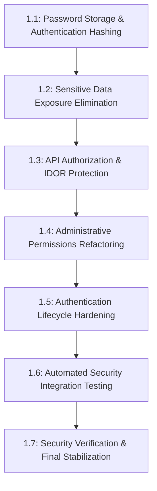

# NexuTS — Phase 1: Security & Authentication Plan

## 1. Executive Summary
Phase 1 focuses exclusively on remediating critical vulnerabilities identified during the Phase 0 baseline: plaintext password handling, public exposure of credentials on project endpoints, broken object-level authorization (BOLA/IDOR), and hardcoded administrative permissions.

Fixes are strictly ordered by severity and exploitability. Public credential exposure and anonymous access must be resolved immediately at the start of Phase 1.

---

## 2. Security Remediation Priority Order



---

## 3. Detailed Step-by-Step Implementation Guidance

### Step 1.1 — Password Storage & Authentication
* **Severity:** Critical (CWE-256: Plaintext Storage of Password)
* **Objective:** Hash passwords using `bcryptjs` upon registration, password change, and implement lazy migration for existing plaintext accounts without downtime or credential exposure.
* **Dependencies:** `bcryptjs` (already installed in `package.json`).
* **Target Files:**
  - `src/app/api/auth/register/route.ts`
  - `src/auth.ts`
  - `src/actions/auth.ts`
  - `src/app/api/auth/profile/route.ts`
* **Implementation Strategy:**
  1. **Registration:** Hash incoming password with `bcrypt.hash(password, 12)` before `prisma.user.create`.
  2. **Authentication / Lazy Migration:**
     - In `CredentialsProvider.authorize`:
     - If the stored password matches bcrypt hash pattern (`^\$2[aby]\$\d{2}\$...`):
       - Use `await bcrypt.compare(credentials.password, user.password)`.
     - Else (legacy plaintext password):
       - Compare securely using constant-time string comparison (`crypto.timingSafeEqual`).
       - If valid, immediately upgrade the user's password in the database:
         ```typescript
         const hashedPassword = await bcrypt.hash(credentials.password, 12);
         await prisma.user.update({
           where: { id: user.id },
           data: { password: hashedPassword },
         });
         ```
  3. **Safety Guarantee:** Legacy users are never locked out; no credentials are displayed or logged; passwords become progressively hashed upon first login.
* **Acceptance Criteria:**
  - New registrations store bcrypt hashes (length 60, starting with `$2a$` or `$2b$`).
  - Existing accounts log in successfully and their database record is upgraded to a bcrypt hash.
  - Plaintext password checks are completely eliminated once migration is complete.

---

### Step 1.2 — Sensitive Data Exposure Elimination
* **Severity:** Critical (CWE-200: Exposure of Sensitive Information to an Unauthorized Actor)
* **Objective:** Completely prevent passwords, session secrets, and internal fields from ever being returned by APIs.
* **Dependencies:** Step 1.1.
* **Target Files:**
  - `src/app/api/projects/route.ts`
  - `src/app/api/projects/[projectId]/route.ts`
  - `src/app/api/users/route.ts`
  - `src/app/api/users/options/route.ts`
* **Implementation Strategy:**
  1. Replace broad `include: { user: true }` with explicit, safe field selections:
     ```typescript
     include: {
       tables: true,
       user: {
         select: {
           id: true,
           name: true,
           email: true,
           image: true,
         },
       },
     }
     ```
  2. In `GET /api/users` and `/api/users/options`, ensure `password` is never included in the select projection.
  3. Implement a serialization sanitizer utility `sanitizeUser(user)` that strips `password` as an additional layer of defense.
* **Acceptance Criteria:**
  - Calling `GET /api/projects` and `GET /api/projects/[id]` produces zero `"password"` keys in the response body.
  - Verified across both anonymous and authenticated calls.

---

### Step 1.3 — API Authorization & BOLA/IDOR Protection
* **Severity:** High (CWE-285: Improper Authorization, CWE-639: IDOR)
* **Objective:** Ensure all project, table, and entry endpoints require an active session and enforce project ownership or assignment rules.
* **Dependencies:** Step 1.2.
* **Target Files:**
  - `src/app/api/projects/route.ts`
  - `src/app/api/projects/[projectId]/route.ts`
  - `src/app/api/tables/route.ts`
  - `src/app/api/tables/[tableId]/entries/route.ts`
  - `src/app/api/entries/route.ts`
* **Implementation Strategy:**
  1. **Authentication Requirement:**
     - Enforce `const session = await auth(); if (!session?.user) return NextResponse.json({ error: "Unauthorized" }, { status: 401 });` at the top of every handler.
  2. **Object-Level Authorization (BOLA):**
     - Verify the authenticated user owns or has access to the target `projectId` before returning tables.
     - For `POST /api/entries`, `PUT /api/entries`, and `DELETE /api/entries`, verify that the target table belongs to a project the user has permission to access.
     - Never allow anonymous clients to create, edit, or delete test cases.
* **Acceptance Criteria:**
  - Anonymous requests to `/api/projects`, `/api/tables`, and `/api/entries` return `HTTP 401 Unauthorized`.
  - Non-authorized users attempting to access or modify other users' private tables/entries return `HTTP 403 Forbidden` or `HTTP 404 Not Found`.

---

### Step 1.4 — Administrative Permissions Refactoring
* **Severity:** High (CWE-798: Use of Hard-coded Credentials/Roles)
* **Objective:** Remove the hardcoded email check in `src/lib/auth/roles.ts` and rely strictly on the database `User.role` field with safe initial admin bootstrapping.
* **Dependencies:** Step 1.3.
* **Target Files:**
  - `src/lib/auth/roles.ts`
  - `src/auth.ts`
  - `src/app/api/users/route.ts`
* **Implementation Strategy:**
  1. Remove `ADMIN_EMAILS = new Set(["yousif.aldhafari@gmail.com"])`.
  2. Rely on `user.role === "ADMIN"` stored in the database.
  3. Define a safe initial admin provisioning mechanism:
     - If no `ADMIN` user exists in the database, allow the first registered user to become `ADMIN` or provide an environment-driven seed command.
  4. Ensure standard registration via `/api/auth/register` assigns role `USER` unconditionally.
* **Acceptance Criteria:**
  - Admin access is determined dynamically from the database.
  - Arbitrary users registering with particular email domains or addresses cannot gain administrative rights.

---

### Step 1.5 — Authentication Lifecycle Hardening
* **Severity:** Medium (CWE-384: Session Fixation, CWE-613: Insufficient Session Expiration)
* **Objective:** Strengthen session configuration, cookie attributes, email verification logic, and password change operations.
* **Dependencies:** Steps 1.1–1.4.
* **Target Files:**
  - `src/auth.ts`
  - `src/actions/auth.ts`
  - `src/app/api/auth/profile/route.ts`
  - `src/app/api/auth/verify-email/route.ts`
* **Implementation Strategy:**
  1. Review JWT expiration and sliding-window refresh logic.
  2. Enforce minimum password complexity (length >= 8, uppercase, lowercase, numbers/symbols).
  3. In `PUT /api/auth/profile`, require verification of the current password before updating to a new password.
  4. Address cookie security warnings in `src/lib/cookie.client.ts`.
* **Acceptance Criteria:**
  - Profile password change requires current password validation.
  - Weak passwords (< 8 characters) are rejected on registration and reset.

---

### Step 1.6 — Automated Security Integration Testing
* **Severity:** Quality & Regression Assurance
* **Objective:** Install and configure an automated test runner (Vitest) and establish comprehensive security test suites.
* **Dependencies:** Steps 1.1–1.5.
* **Target Files:**
  - `package.json` (add Vitest & scripts)
  - `vitest.config.ts`
  - `src/tests/security/auth.test.ts`
  - `src/tests/security/bola.test.ts`
  - `src/tests/security/data-exposure.test.ts`
* **Implementation Strategy:**
  1. Install `vitest` and `@testing-library/react` as dev dependencies.
  2. Create test suites covering:
     - Anonymous access to all API routes (must return 401).
     - Regular user attempting admin endpoints (`/api/users`) -> 403.
     - Regular user attempting cross-project entry mutation -> 403/404.
     - Verification that `password` is absent in all serialized user responses.
     - Hashing verification upon registration and lazy migration.
* **Acceptance Criteria:**
  - `npm test` runs cleanly and validates all security boundaries.

---

### Step 1.7 — Security Verification & Final Stabilization
* **Severity:** Release Assurance
* **Objective:** Run full regression passes, verify database integrity, re-validate production build, and document resolved vulnerabilities.
* **Dependencies:** Steps 1.1–1.6.
* **Implementation Strategy:**
  1. Run full quality gate sequence (TypeScript, Biome lint, Vitest, Next.js build).
  2. Re-verify `prisma/dev.db` checksum remains pristine.
  3. Prepare Phase 1 final verification report for review before merging to `main`.
* **Acceptance Criteria:**
  - All 7 quality gates pass. Zero regression in existing dashboard and QA board functionality.

