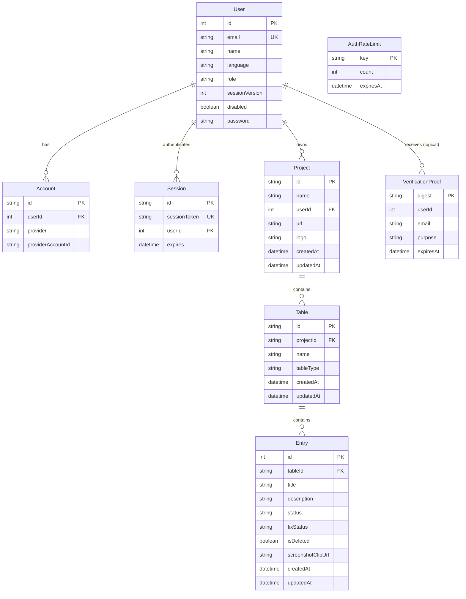

# NexuTS — Phase 2, Step 2.1 Database Schema, Relationships & Migration Audit

## 1. Executive Summary

This audit establishes the concrete architectural and relational baseline for **Phase 2: Database Integrity, Relationships & Performance** in NexuTS. Conducted on branch `phase/2-database-integrity` starting from the Phase 1 production merge commit (`1ad7689884393d8cbfe8e59d3f26721b19e4c46c`), this investigation inspects Prisma definitions, SQLite schema catalogs, migration histories, foreign key cascades, and runtime query patterns against disposable SQLite instances.

### Key Audit Findings
1. **Critical Index Deficiencies:** Foreign key references across core tables (`Entry.tableId`, `Table.projectId`, `Project.userId`, `Account.userId`, `Session.userId`) have **zero secondary indexes** in SQLite, resulting in full table scans on all relationship queries.
2. **Missing Referential Integrity:** `VerificationProof.userId` lacks a foreign key constraint to `User.id`, risking orphaned proof digests upon user deletion.
3. **Column Overloading:** `Entry.status` is overloaded to hold test execution status (`"SUCCESS"`, `"FAIL"`) for test cases, but holds issue priority (`"HIGH"`, `"MEDIUM"`, `"LOW"`) for issue logs due to the absence of a dedicated `priority` column.
4. **Row Bloat from Inline Base64 Media:** `Entry.screenshotClipUrl` stores large base64 data payloads (up to 12–16 MiB) inline within SQLite rows, causing B-tree overflow chains and query latency.
5. **Single-Owner Limitation:** Projects currently support only a single nullable owner (`Project.userId`), preventing team collaboration and risking unowned/orphaned projects when an account is deleted.
6. **Unbounded Queries:** `findMany` queries for projects, tables, and entries lack pagination, exposing memory exhaustion risks.

*Note: Per Step 2.1 specifications, no schema modifications or code alterations are introduced in this discovery step.*

---

## 2. Complete Model & Field Inventory

| Model | Field | Type | Nullability | Constraints / Attributes | Description |
| :--- | :--- | :--- | :---: | :--- | :--- |
| **`User`** | `id` | `Int` | NOT NULL | `@id @default(autoincrement())` | Primary key |
| | `name` | `String` | NULL | | User display name |
| | `email` | `String` | NULL | `@unique` | Unique login email |
| | `language` | `String` | NOT NULL | `@default("en")` | User interface locale (`en`, `ar`) |
| | `role` | `String` | NOT NULL | `@default("USER")` | RBAC role (`ADMIN`, `USER`) |
| | `sessionVersion` | `Int` | NOT NULL | `@default(0)` | Session invalidation epoch |
| | `disabled` | `Boolean` | NOT NULL | `@default(false)` | Account suspension flag |
| | `emailVerified` | `DateTime` | NULL | | Email verification timestamp |
| | `image` | `String` | NULL | | Profile avatar URL |
| | `password` | `String` | NULL | | Bcrypt password hash |
| **`Account`** | `id` | `String` | NOT NULL | `@id @default(cuid())` | Primary key |
| | `userId` | `Int` | NOT NULL | FK ➔ `User.id` (`ON DELETE CASCADE`) | Owning user account |
| | `type` | `String` | NOT NULL | | NextAuth account type |
| | `provider` | `String` | NOT NULL | Compound Unique `[provider, providerAccountId]` | OAuth provider name |
| | `providerAccountId`| `String` | NOT NULL | Compound Unique `[provider, providerAccountId]` | Provider-specific account ID |
| | `refresh_token` | `String` | NULL | | OAuth refresh token |
| | `access_token` | `String` | NULL | | OAuth access token |
| | `expires_at` | `Int` | NULL | | Token expiration epoch |
| | `token_type` | `String` | NULL | | OAuth token type |
| | `scope` | `String` | NULL | | OAuth permissions scope |
| | `id_token` | `String` | NULL | | OpenID Connect ID token |
| | `session_state` | `String` | NULL | | OAuth session state |
| **`Session`** | `id` | `String` | NOT NULL | `@id @default(cuid())` | Primary key |
| | `sessionToken` | `String` | NOT NULL | `@unique` | NextAuth session token |
| | `userId` | `Int` | NOT NULL | FK ➔ `User.id` (`ON DELETE CASCADE`) | Owning user ID |
| | `expires` | `DateTime` | NOT NULL | | Session expiration timestamp |
| **`Project`** | `id` | `String` | NOT NULL | `@id @default(cuid())` | Primary key |
| | `name` | `String` | NOT NULL | | Project title |
| | `url` | `String` | NULL | | Web project URL |
| | `logo` | `String` | NULL | | Base64 or URL logo |
| | `createdBy` | `String` | NULL | | Redundant creator name string |
| | `userId` | `Int` | NULL | FK ➔ `User.id` (`ON DELETE SET NULL`) | Project owner ID |
| | `createdAt` | `DateTime` | NOT NULL | `@default(now())` | Creation timestamp |
| | `updatedAt` | `DateTime` | NOT NULL | `@updatedAt` | Last modification timestamp |
| **`Table`** | `id` | `String` | NOT NULL | `@id @default(cuid())` | Primary key |
| | `projectId` | `String` | NOT NULL | FK ➔ `Project.id` (`ON DELETE CASCADE`) | Owning project ID |
| | `name` | `String` | NOT NULL | | QA table name |
| | `tableType` | `String` | NOT NULL | `@default("TEST_CASES")` | Table kind (`TEST_CASES`, `ISSUE_LOGS`)|
| | `createdBy` | `String` | NULL | | Redundant creator name string |
| | `createdAt` | `DateTime` | NOT NULL | `@default(now())` | Creation timestamp |
| | `updatedAt` | `DateTime` | NOT NULL | `@updatedAt` | Last modification timestamp |
| **`Entry`** | `id` | `Int` | NOT NULL | `@id @default(autoincrement())` | Primary key |
| | `tableId` | `String` | NOT NULL | FK ➔ `Table.id` (`ON DELETE CASCADE`) | Owning table ID |
| | `title` | `String` | NOT NULL | | Entry summary / title |
| | `description` | `String` | NOT NULL | | Detailed reproduction description |
| | `status` | `String` | NOT NULL | `@default("NEW")` | Status / Priority (Overloaded) |
| | `assignedTo` | `String` | NULL | | Assignee username/email string |
| | `isDeleted` | `Boolean` | NOT NULL | `@default(false)` | Soft-delete flag |
| | `username` | `String` | NULL | | Submitter username |
| | `stepsToReproduce`| `String` | NULL | | Execution steps |
| | `fixStatus` | `String` | NULL | | Verification state |
| | `result` | `String` | NULL | | Actual result observed |
| | `expectedResult` | `String` | NULL | | Expected behavior |
| | `screenshotClipName`|`String` | NULL | | Attachment filename |
| | `screenshotClipUrl` |`String` | NULL | | Base64 media data / URL (Up to 12 MB) |
| | `createdAt` | `DateTime` | NOT NULL | `@default(now())` | Creation timestamp |
| | `updatedAt` | `DateTime` | NOT NULL | `@updatedAt` | Last modification timestamp |
| **`VerificationProof`**|`digest` | `String` | NOT NULL | `@id` | Primary key (SHA-256 token digest) |
| | `userId` | `Int` | NOT NULL | Missing FK ➔ `User.id` | Target user account ID |
| | `email` | `String` | NOT NULL | | Bound recipient email address |
| | `purpose` | `String` | NOT NULL | | Token purpose (`verify-email`) |
| | `expiresAt` | `DateTime` | NOT NULL | Compound Index `[userId, purpose]` | Expiration timestamp |
| **`AuthRateLimit`** | `key` | `String` | NOT NULL | `@id` | Primary key (Rate limit key hash) |
| | `count` | `Int` | NOT NULL | | Accumulated attempt count |
| | `expiresAt` | `DateTime` | NOT NULL | Index `[expiresAt]` | Window expiration timestamp |

---

## 3. Entity-Relationship (ER) Diagram



---

## 4. Actual Database Constraints, Foreign Keys & Indexes

Physical SQLite schema introspection was conducted using `DatabaseSync` on disposable migration targets:

### 4.1 Foreign Key Referential Actions
1. `Account.userId` ➔ `User.id`: `ON UPDATE CASCADE ON DELETE CASCADE` (Verified)
2. `Session.userId` ➔ `User.id`: `ON UPDATE CASCADE ON DELETE CASCADE` (Verified)
3. `Project.userId` ➔ `User.id`: `ON UPDATE CASCADE ON DELETE SET NULL` (Verified in SQLite baseline; omitted in `schema.prisma`)
4. `Table.projectId` ➔ `Project.id`: `ON UPDATE CASCADE ON DELETE CASCADE` (Verified)
5. `Entry.tableId` ➔ `Table.id`: `ON UPDATE CASCADE ON DELETE CASCADE` (Verified)
6. `VerificationProof.userId`: **NO FOREIGN KEY CONSTRAINT** (Missing)

### 4.2 SQLite Secondary Indexes Present
- `User_email_key` on `User(email)` (Unique)
- `Account_provider_providerAccountId_key` on `Account(provider, providerAccountId)` (Unique)
- `Session_sessionToken_key` on `Session(sessionToken)` (Unique)
- `VerificationProof_userId_purpose_idx` on `VerificationProof(userId, purpose)` (Non-unique)
- `AuthRateLimit_expiresAt_idx` on `AuthRateLimit(expiresAt)` (Non-unique)

### 4.3 Missing Secondary Indexes
- `Entry(tableId)`: **MISSING**. Causes full table scans for all entry queries.
- `Entry(tableId, isDeleted)`: **MISSING**. Critical for soft-delete queries.
- `Table(projectId)`: **MISSING**. Causes full table scans when listing project tables.
- `Project(userId)`: **MISSING**. Causes full table scans when filtering projects by user.
- `Account(userId)`: **MISSING**.
- `Session(userId)`: **MISSING**.

### 4.4 Active SQLite Invariant Triggers
Extracted from `sqlite_master`:
1. `protect_last_admin_update`:
   `BEFORE UPDATE OF role, disabled ON "User"`: Aborts modification (`RAISE(ABORT, 'LAST_ADMIN')`) if active admin count is `<= 1`.
2. `protect_last_admin_delete`:
   `BEFORE DELETE ON "User"`: Aborts deletion (`RAISE(ABORT, 'LAST_ADMIN')`) if active admin count is `<= 1`.
3. `revoke_password_sessions`:
   `AFTER UPDATE OF password ON "User"`: Increments `sessionVersion = sessionVersion + 1`.
4. `revoke_role_sessions`:
   `AFTER UPDATE OF role, disabled, email ON "User"`: Increments `sessionVersion`, clears `emailVerified` on email update, and purges `VerificationProof` records for `userId`.

---

## 5. Migration History & Upgrade Compatibility Assessment

### 5.1 Migration Inventory
1. `20260512000000_baseline`:
   Constructs initial tables (`User`, `Account`, `Session`, `Project`, `Table`, `Entry`). Verified safe for fresh deployments.
2. `20260512181500_add_user_language`:
   Executes `ALTER TABLE "User" ADD COLUMN "language" TEXT NOT NULL DEFAULT 'en';`.
3. `20261028010000_auth_lifecycle`:
   Adds `sessionVersion`, `disabled`, `VerificationProof`, `AuthRateLimit`, indexes, and SQLite triggers.

### 5.2 Upgrade vs. Fresh Verification
- Verified via automated suite `tests/migrations/migrations.test.cjs`:
  - **Fresh Database:** All 3 migrations execute in sequence without warnings.
  - **Upgrade Database:** Pre-Step-1.5 baseline adoption correctly preserves existing data and applies the additive lifecycle migration cleanly.

---

## 6. Confirmed Data Integrity Issues

### 6.1 Issue A: Missing Secondary Indexes on Relationship Joins
- **Severity:** High (Performance & Scalability)
- **Files Affected:** `prisma/schema.prisma#L68-L98`, `src/app/api/tables/[tableId]/entries/route.ts#L18`, `src/app/api/entries/route.ts#L21`
- **Finding:** Neither Prisma nor the SQL baseline indexes `Entry.tableId`, `Table.projectId`, or `Project.userId`. In SQLite, foreign key columns do not receive implicit indexes. Every dashboard page load filtering entries by `tableId` and `isDeleted` scans the entire `Entry` table.

### 6.2 Issue B: Missing Foreign Key on `VerificationProof`
- **Severity:** Medium (Referential Integrity)
- **Files Affected:** `prisma/schema.prisma#L100-L107`, `prisma/migrations/20261028010000_auth_lifecycle/migration.sql#L4-L8`
- **Finding:** `VerificationProof` contains an unconstrained `userId Int`. If a user is deleted, any lingering tokens remain orphaned in the database.

### 6.3 Issue C: Column Overloading on `Entry.status`
- **Severity:** High (Domain Integrity & Maintainability)
- **Files Affected:** `src/lib/qa-entry-schema.ts#L88-L146`, `src/app/(main)/dashboard/qa-boards/`
- **Finding:** For `TEST_CASES` tables, `Entry.status` stores `"SUCCESS"` or `"FAIL"`. For `ISSUE_LOGS` tables, `Entry.status` is overloaded to store priority (`"HIGH"`, `"MEDIUM"`, `"LOW"`), as evidenced by `src/lib/qa-entry-schema.ts#L135`. The database schema has no `priority` column, conflating test execution results with issue severity.

### 6.4 Issue D: Inline Base64 Binary Storage
- **Severity:** High (Storage & Query Latency)
- **Files Affected:** `prisma/schema.prisma#L97`, `src/lib/auth/mutation-guard.ts#L49-L58`
- **Finding:** `Entry.screenshotClipUrl` accepts base64 strings up to 12 MiB directly into table rows. SQLite stores values exceeding page size (~4 KiB) across linked overflow pages. Repeated queries on `Entry` force SQLite to read and cache large overflow pages even when screenshots are not displayed.

### 6.5 Issue E: Single-Owner Architecture & Unowned Project Risk
- **Severity:** High (Collaboration & Authorization)
- **Files Affected:** `prisma/schema.prisma#L61-L62`, `src/lib/auth/access-control.ts#L61-L74`
- **Finding:** `Project.userId` is nullable with `ON DELETE SET NULL`. If an owner's account is removed, the project is orphaned. Furthermore, legitimate multi-user teams cannot share project access or assign collaborator roles.

### 6.6 Issue F: Unbounded Queries
- **Severity:** Medium (Resource Exhaustion)
- **Files Affected:** `src/app/api/projects/route.ts#L36`, `src/app/api/tables/route.ts#L22`, `src/app/api/tables/[tableId]/entries/route.ts#L18`
- **Finding:** Endpoints execute `prisma.*.findMany` without `take`, `skip`, or cursor limits. Large datasets threaten memory consumption in the server process.

---

## 7. Security and Ownership Implications

1. **Orphaned Project Vulnerability:** When `Project.userId` is NULL, access control (`src/lib/auth/access-control.ts`) restricts access exclusively to global `ADMIN` users. No user-level transfer or recovery workflow exists.
2. **De-normalized Audit Columns:** `Project.createdBy` and `Table.createdBy` store arbitrary strings without referential integrity to `User`. Audit tracking cannot be verified if an account's name changes.
3. **Soft-Delete Leakage Risk:** Because soft deletes are managed via `isDeleted: Boolean` without compound indexes or database views, custom queries that omit `where: { isDeleted: false }` risk leaking archived entries.

---

## 8. Recommendations for Phase 2 Steps (2.2 — 2.6)

### Step 2.2 — Performance Indexes & Query Optimization
- Introduce explicit indexes in `schema.prisma`:
  - `Entry`: `@@index([tableId, isDeleted])`, `@@index([isDeleted])`
  - `Table`: `@@index([projectId])`
  - `Project`: `@@index([userId])`
  - `Account`: `@@index([userId])`
  - `Session`: `@@index([userId])`
- Add pagination (`cursor` / `take`) to entry and project query endpoints.

### Step 2.3 — Domain Integrity & Schema Disambiguation
- Add dedicated `priority` column (`String?` or Enum) to `Entry`.
- Migrate overloaded issue log priorities from `Entry.status` to `Entry.priority`.
- Enforce strict enum validations and check constraints for `tableType`, `status`, and `priority`.
- Align `Project.userId` onDelete definition in `schema.prisma` with baseline SQL (`onDelete: SetNull`).

### Step 2.4 — Referential Integrity & Orphan Prevention
- Add foreign key relation from `VerificationProof.userId` to `User.id` (`onDelete: Cascade`).
- Replace untyped `createdBy` strings with foreign key relations or remove redundant columns.
- Add compound unique constraints: `Table: @@unique([projectId, name])`.

### Step 2.5 — Multi-User Project Collaboration Model
- Introduce `ProjectMember` junction model:
  ```prisma
  model ProjectMember {
    id        String      @id @default(cuid())
    projectId String
    project   Project     @relation(fields: [projectId], references: [id], onDelete: Cascade)
    userId    Int
    user      User        @relation(fields: [userId], references: [id], onDelete: Cascade)
    role      ProjectRole @default(MEMBER)
    createdAt DateTime    @default(now())

    @@unique([projectId, userId])
    @@index([userId])
    @@index([projectId])
  }

  enum ProjectRole {
    OWNER
    ADMIN
    EDITOR
    VIEWER
  }
  ```
- Backfill existing `Project.userId` owners into `ProjectMember` with role `OWNER`.
- Update `access-control.ts` to evaluate project membership alongside system administrator roles.

### Step 2.6 — Media Storage Optimization & External Blob Architecture
- Decouple multi-megabyte `screenshotClipUrl` payloads from the core `Entry` table row.
- Move media binaries to an isolated `EntryAttachment` table or local/cloud object storage, storing lightweight references in `Entry`.

---

## 9. Source Code References Supporting Findings

- [prisma/schema.prisma](file:///mnt/samsungSSD/Projects/Nexumind/NexuTS/prisma/schema.prisma#L1-L114): Model definitions, missing indexes, missing FK on `VerificationProof`.
- [prisma/migrations/20260512000000_baseline/migration.sql](file:///mnt/samsungSSD/Projects/Nexumind/NexuTS/prisma/migrations/20260512000000_baseline/migration.sql#L39-L80): Baseline SQL schema and cascade constraints.
- [prisma/migrations/20261028010000_auth_lifecycle/migration.sql](file:///mnt/samsungSSD/Projects/Nexumind/NexuTS/prisma/migrations/20261028010000_auth_lifecycle/migration.sql#L1-L30): Unconstrained `VerificationProof` creation and SQLite triggers.
- [src/lib/qa-entry-schema.ts](file:///mnt/samsungSSD/Projects/Nexumind/NexuTS/src/lib/qa-entry-schema.ts#L88-L146): Overloading of `Entry.status` with issue priority.
- [src/lib/auth/access-control.ts](file:///mnt/samsungSSD/Projects/Nexumind/NexuTS/src/lib/auth/access-control.ts#L61-L105): Single-owner authorization checks and unowned project handling.
- [src/app/api/entries/route.ts](file:///mnt/samsungSSD/Projects/Nexumind/NexuTS/src/app/api/entries/route.ts#L8-L42): Entry creation and unindexed lookups.
- [src/lib/auth/mutation-guard.ts](file:///mnt/samsungSSD/Projects/Nexumind/NexuTS/src/lib/auth/mutation-guard.ts#L49-L59): 12 MiB payload limit for `screenshotClipUrl`.
